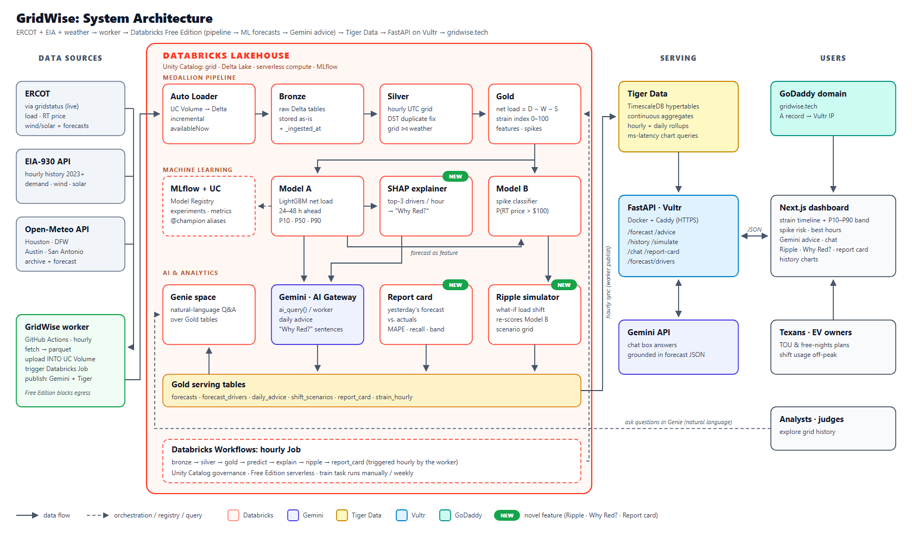

# ⚡ GridWise

### Know when the Texas grid will be stressed, and what to do about it.

GridWise forecasts **when Texas's power grid (ERCOT) will be strained and when wholesale prices will spike, 24–48 hours ahead**, then turns that forecast into plain-English advice: *"run the dryer after 10 pm, pre-cool the house before 4 pm, charge the EV overnight."*

Built at **TAMUhack 26** · Tracks: **Databricks** · **Gemini** · **Tiger Data** · **Vultr** · **GoDaddy Registry**

> **"GridWise forecasts when Texas's power grid will be stressed and tells you exactly when to run your dryer, charge your EV, or crank the AC, so you save money and help keep the lights on."**

---

## Why this matters

Texas runs its own power grid. ERCOT serves about 90% of the state's electricity load and is mostly **isolated** from the rest of the US, so when supply gets tight, Texas can't just import power from its neighbors.

- **Winter Storm Uri (Feb 2021)** left more than 4.5 million Texas homes and businesses without power, some for days.
- On hot summer evenings, demand peaks just as **solar output fades**. That gap has to be filled by gas plants, and it's when the grid is most fragile.
- **Wholesale prices can jump 50–100×** within hours when reserves run low. Customers on time-of-use, "free nights" or variable-rate plans, and EV owners, feel that directly.

ERCOT publishes a lot of data, but it's raw and hard to read. **Most people have no simple way to know when the grid will be tight tomorrow, or what to do about it.** GridWise closes that gap.

## What GridWise does

| | Feature | What you see |
|---|---|---|
| 🚦 | **Strain timeline** | Tomorrow's 48 hours, colored green / yellow / red by a 0–100 strain index |
| 💸 | **Price-spike risk** | The probability each hour that real-time prices exceed $100/MWh |
| 🕐 | **Best hours card** | The cheapest, lowest-stress windows to run appliances or charge an EV |
| 🤖 | **Gemini advice** | A daily plain-English plan, plus a chat box: *"When should I charge my EV tomorrow?"* |
| 🔎 | **Genie Q&A** | Ask the grid's history in plain English: *"What was the most strained hour of summer 2025?"* |
| 🌊 | **Ripple simulator** *(novel)* | *"What if 5% of Texas homes shifted their dryer to 10 pm?"* Watch the red zone shrink, re-scored by the real models |
| ❓ | **"Why Red?" + report card** *(novel)* | Every red hour explains its top 3 drivers (heat, low wind, solar fade), shows a confidence band, and yesterday's forecast is graded against reality |

The key metric is **net load = demand − wind − solar**: the part of demand that gas plants have to cover. That, more than total demand, is what drives strain and price spikes.

## How it works



1. **Ingest:** a Python worker pulls ERCOT data (via [gridstatus](https://github.com/gridstatus/gridstatus)), EIA-930 hourly history, and Open-Meteo weather for Houston, DFW, Austin and San Antonio. It lands raw parquet into a Unity Catalog Volume every hour.
2. **Lakehouse (Databricks):** Auto Loader → **Bronze** (raw) → **Silver** (hourly UTC, DST-safe, deduped, grid + weather joined) → **Gold** (net load, strain index, spike events, model features).
3. **Machine learning (MLflow + Unity Catalog):**
   - **Model A:** a LightGBM net-load forecast for the next 1–48 h, with P10/P50/P90 bands.
   - **Model B:** a price-spike classifier.
   - **SHAP:** explains every forecast hour.
4. **AI layer:** **Gemini** writes the daily advice and "Why Red?" sentences inside the pipeline; **Genie** answers natural-language questions over the Gold tables.
5. **Serving:** forecasts sync to **Tiger Data** (TimescaleDB hypertables + continuous aggregates), a **FastAPI** service on **Vultr** serves them, and the dashboard lives on a **GoDaddy** domain.

More detail: [ARCHITECTURE.md](ARCHITECTURE.md) (box diagrams for every flow) · [TECH_STACK.md](TECH_STACK.md)

### A detail judges ask about: daylight saving time

ERCOT reports in Central time. Every November, the 1:00 am hour happens **twice**, and every March, 2:00 am **doesn't exist**. Joined naively, that hour gets dropped or double-counted. GridWise keeps the original local time with its UTC offset, converts everything to UTC before aggregating, and shows the check in the Silver notebook.

## Who it's for

- **Households on time-of-use or variable-rate plans:** shift laundry, dishwashers and pool pumps to save money.
- **EV owners:** charge in the cheapest, cleanest hours.
- **Anyone who wants to help prevent outages:** small shifts by many homes add up (that's what Ripple shows).
- **Businesses:** retail electricity providers, EV fleets, smart-home and demand-response companies.

👉 Full personas, user journeys and business use cases: **[CUSTOMERS.md](CUSTOMERS.md)**

## Project status

| Phase | Status |
|---|---|
| 1. Setup & ingestion → Bronze | ✅ Done: 2023 → today loaded (EIA 33.9k hours, prices 134.6k rows, weather 134.5k rows) |
| 2. Silver & Gold | 🔄 In progress: Silver built, Gold building |
| 3. Machine learning | 🔄 Training notebook drafted |
| 4. AI layer & automation | ⏳ |
| 5. Serving & dashboard | ⏳ |
| 6. Ship | ⏳ |

The step-by-step plan is in [PHASES.md](PHASES.md); the scope and success criteria are in [PROJECT_SCOPE.md](PROJECT_SCOPE.md).

## Run it yourself

**Prerequisites:** Python 3.12, a free [Databricks Free Edition](https://www.databricks.com/learn/free-edition) workspace, and a free [EIA API key](https://www.eia.gov/opendata/register.php).

```powershell
git clone https://github.com/AymanM7/gridwise.git
cd gridwise
python -m venv .venv
.venv\Scripts\activate                      # macOS/Linux: source .venv/bin/activate
pip install -r ingestion/requirements.txt
copy .env.example .env                      # then fill in EIA_API_KEY (and others as you reach them)
python tools/check_secrets.py --install   # blocks commits that contain secrets

python -m tools.login https://<your-workspace>.cloud.databricks.com   # browser login, saves a token to .env
python -m tools.deploy --run 00_setup      # creates catalog/schemas/volumes
python -m ingestion.cli backfill --start 2023-01-01   # ~10 min, history → Databricks
python -m ingestion.cli ingest                 # latest live data
python -m tools.deploy --run 01_bronze     # load Bronze tables
python -m tools.sql "SELECT count(*) FROM grid.bronze.eia_hourly"
```

Add `--local-only` to any `ingestion.cli` command to test without Databricks (it writes to `data/landing/`).

### Why there's a "worker"

Databricks Free Edition restricts outbound internet from notebooks, so a small worker fetches data outside Databricks and uploads it **into** a Unity Catalog Volume, which is always allowed. Everything else (transforms, ML, Gemini, Genie, the hourly Job) runs in Databricks.

## Repository layout

```text
gridwise/
├── ingestion/        📥 DATA INGESTION: fetch ERCOT · EIA · Open-Meteo, upload into Databricks
│   └── sources/        ercot.py · eia.py · weather.py
├── pipeline/         🏗️ DATABRICKS PIPELINE: 00_setup → 01_bronze → 02_silver → 03_gold
├── ml/               🤖 MACHINE LEARNING: 04_train · 05_predict · 06_explain · 07_report_card
├── db/               🗄️ SERVING DATABASE: Tiger Data schema + continuous aggregates  (Phase 5)
├── backend/          🔌 API: FastAPI on Vultr                                       (Phase 5)
├── frontend/         🖥️ DASHBOARD: Next.js at gridwise.tech                          (Phase 5)
├── infra/            🚀 DEPLOYMENT: docker-compose · Caddy · Vultr                   (Phase 5)
├── tools/            🧰 DEV HELPERS: login · deploy · sql · check_secrets
├── docs/             📚 architecture image · data contract · diagram generator
├── .github/workflows/  secret-scan (every push) · gridwise-hourly (pipeline trigger)
└── .gitleaks.toml    secret-detection rules
```
Each folder has its own `README.md` explaining what's inside and how to run it.

## Security

API keys live **only** in `.env`, which is git-ignored. A pre-commit hook (`tools/check_secrets.py`) and a gitleaks GitHub Action (rules in `.gitleaks.toml`) block any commit that contains a key, token or database password.

## Data sources & credits

- **ERCOT** public data via the open-source [gridstatus](https://github.com/gridstatus/gridstatus) library
- **U.S. EIA** Hourly Electric Grid Monitor (EIA-930)
- **Open-Meteo** weather API (free, no key)

GridWise is a hackathon project and **not affiliated with ERCOT**. Forecasts are informational, not grid-operations or financial advice.
