# 🖥️ GridWise Dashboard V3: Complete Architecture

The full architecture of the GridWise dashboard, from raw ERCOT data to the pixels on screen.

> **How to read the diagrams.** Every diagram is a plain-text **system-design box diagram**, so it looks identical in VS Code, on GitHub and in a terminal. Under each one, a collapsible **Mermaid version** renders as an interactive diagram on GitHub.
> Polished image for slides and Devpost: [`docs/architecture.png`](docs/architecture.png).
> Regenerate the box diagrams: `python docs/diagrams/gen_dashboard_v3.py docs/diagrams/DASHBOARD_V3.template.md DASHBOARD_V3.md`

Related: [DASHBOARD_V2.md](DASHBOARD_V2.md) (per-section guide) · [JUDGES.md](JUDGES.md) (demo script) · [ARCHITECTURE.md](ARCHITECTURE.md) (pipeline box diagrams)

---

## Contents

1. [System overview](#1-system-overview)
2. [Data pipeline (Databricks)](#2-data-pipeline-databricks)
3. [Serving layer (Tiger Data + FastAPI)](#3-serving-layer-tiger-data--fastapi)
4. [Tiger Data schema](#4-tiger-data-schema)
5. [API endpoints → dashboard sections](#5-api-endpoints--dashboard-sections)
6. [Frontend architecture](#6-frontend-architecture)
7. [Request flows](#7-request-flows)
8. [Freshness: how new data reaches the page](#8-freshness-how-new-data-reaches-the-page)
9. [Resilience and fallbacks](#9-resilience-and-fallbacks)
10. [Visual layer: shaders and motion](#10-visual-layer-shaders-and-motion)
11. [Deployment topologies](#11-deployment-topologies)
12. [Security model](#12-security-model)
13. [Tech stack summary](#13-tech-stack-summary)

---

## 1. System overview

Three zones: **sources** feed **Databricks** (which computes everything ahead of time), results are copied to **Tiger Data**, and the **API + dashboard** only read from Tiger. Gemini is the one live external call.

{{V1}}

Interactive Mermaid version (renders on GitHub)

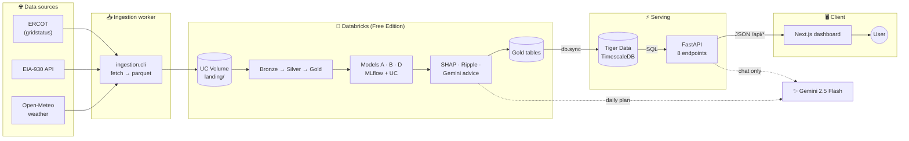

**Design principle:** *precompute everything expensive.* A page view never runs a model and never touches Databricks, so it loads in < 0.5 s and costs **zero** lakehouse compute.

---

## 2. Data pipeline (Databricks)

One Databricks Job, `gridwise-hourly`, chains 9 notebook tasks. Each task writes Gold tables that the dashboard later reads.

{{V2}}

Interactive Mermaid version (renders on GitHub)

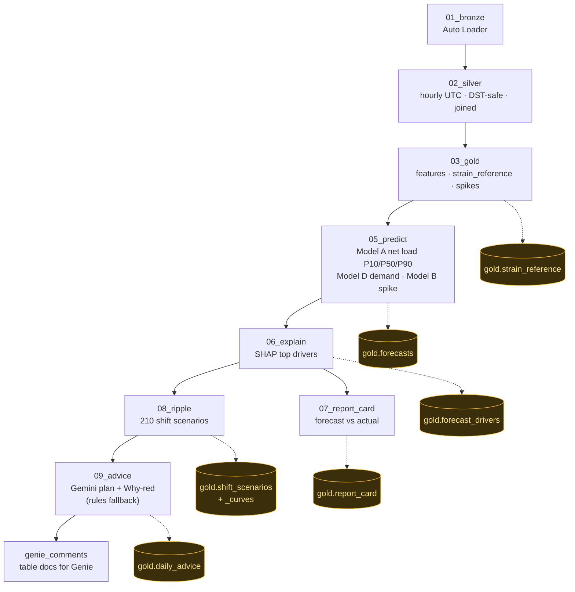

| Model | What it predicts | Test result |
|---|---|---|
| **A** `grid.ml.net_load` | Net load (demand − wind − solar), P10/P50/P90, 1–48 h | MAPE **11.8%** vs 18.6% baseline · band coverage **80.7%** |
| **D** `grid.ml.demand` | Demand, anchored on the last 6 actual hours | MAPE **3.45%** |
| **B** `grid.ml.spike` | P(real-time price > $100/MWh) | Recall **0.81** · ROC-AUC **0.93** |

**Strain index (0–100)** = percentile of forecast net load within the same month historically (`strain_reference`), +15 if spike risk > 50%. 🟢 < 60 · 🟡 60–85 · 🔴 > 85.

---

## 3. Serving layer (Tiger Data + FastAPI)

{{V3}}

Interactive Mermaid version (renders on GitHub)

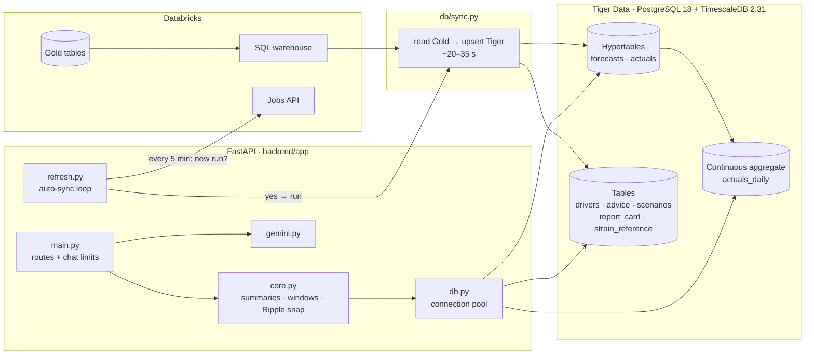

| Module | Responsibility |
|---|---|
| `main.py` | 8 routes, CORS, chat limits (≤ 500 chars, 10/min per IP, global Gemini cap) |
| `core.py` | Latest run lookup, hour summaries, best/avoid windows, Ripple nearest-scenario snapping, rules answers |
| `db.py` | psycopg 3 connection pool (lazy open; serverless-friendly) |
| `gemini.py` | Grounded chat prompt → `{answer, highlight_hours}`, cache, error handling |
| `refresh.py` | Background loop: Jobs API poll → `db.sync` subprocess, advisory lock |

---

## 4. Tiger Data schema

{{V4}}

Interactive Mermaid version (renders on GitHub)

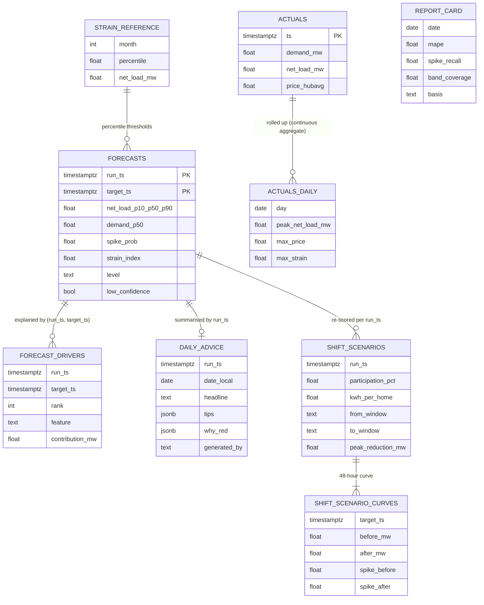

| Table | Kind | Rows (Nov 7) |
|---|---|---|
| `forecasts` | **Hypertable** | 96 |
| `forecast_drivers` | Table | 288 |
| `daily_advice` | Table | 1 |
| `shift_scenarios` / `shift_scenario_curves` | Tables | 210 / 10,080 |
| `report_card` | Table | 92 |
| `strain_reference` | Table | 1,212 |
| `actuals` | **Hypertable** | 9,598 |
| `actuals_daily` | **Continuous aggregate** | 401 |

*(Column lists are simplified to the fields the dashboard uses; see `db/schema.sql` for the full DDL.)*

---

## 5. API endpoints → dashboard sections

{{V5}}

Interactive Mermaid version (renders on GitHub)

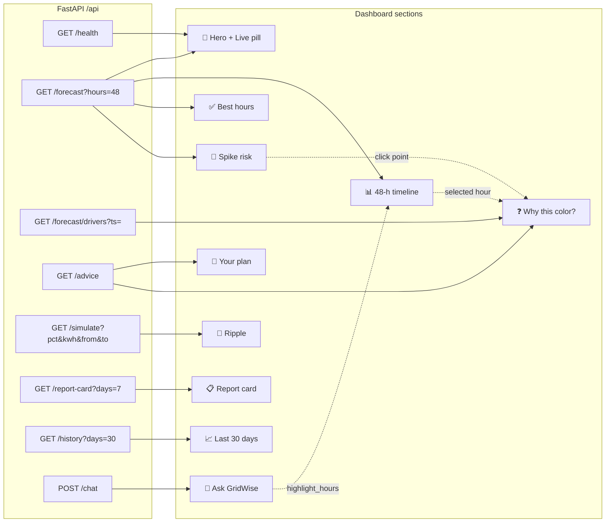

| Endpoint | Tiger source | Typical latency |
|---|---|---|
| `GET /api/health` | `forecasts` (latest `run_ts`) | ~50 ms |
| `GET /api/forecast` | `forecasts` + `strain_reference` | ~110 ms |
| `GET /api/forecast/drivers` | `forecast_drivers` + `daily_advice.why_red` | ~190 ms |
| `GET /api/advice` | `daily_advice` | ~200 ms |
| `GET /api/simulate` | `shift_scenarios` + `_curves` | ~160 ms |
| `GET /api/report-card` | `report_card` | ~70 ms |
| `GET /api/history` | `actuals_daily` | ~60 ms |
| `POST /api/chat` | `forecasts` + `daily_advice` → **Gemini** | ~0.8–5 s |

---

## 6. Frontend architecture

### 6.1 Component tree

{{V6}}

Interactive Mermaid version (renders on GitHub)

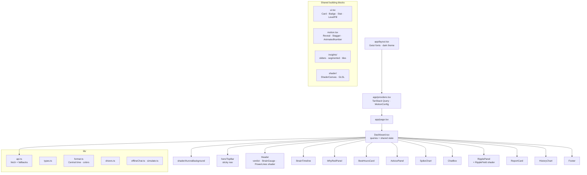

### 6.2 State and data flow inside the page

{{V7}}

Interactive Mermaid version (renders on GitHub)

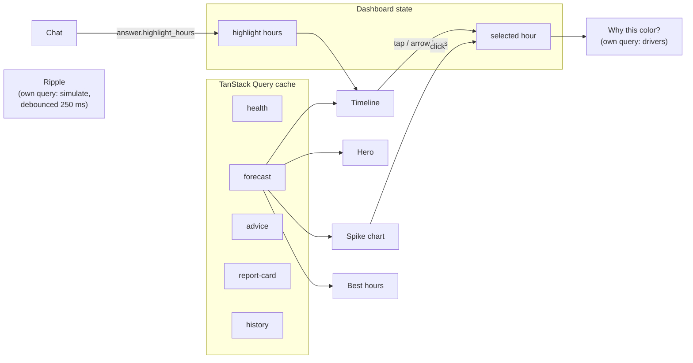

- **On first load**, the most-strained hour is pre-selected so "Why this color?" is never empty.
- **Query policy:** 5-min stale time, auto-refetch every 10 min; report card and history cache for 1 h.
- **Hydration-safe:** loading states use `isPending` (identical on server and client).

---

## 7. Request flows

### 7.1 Page load

{{V8}}

Interactive Mermaid version (renders on GitHub)

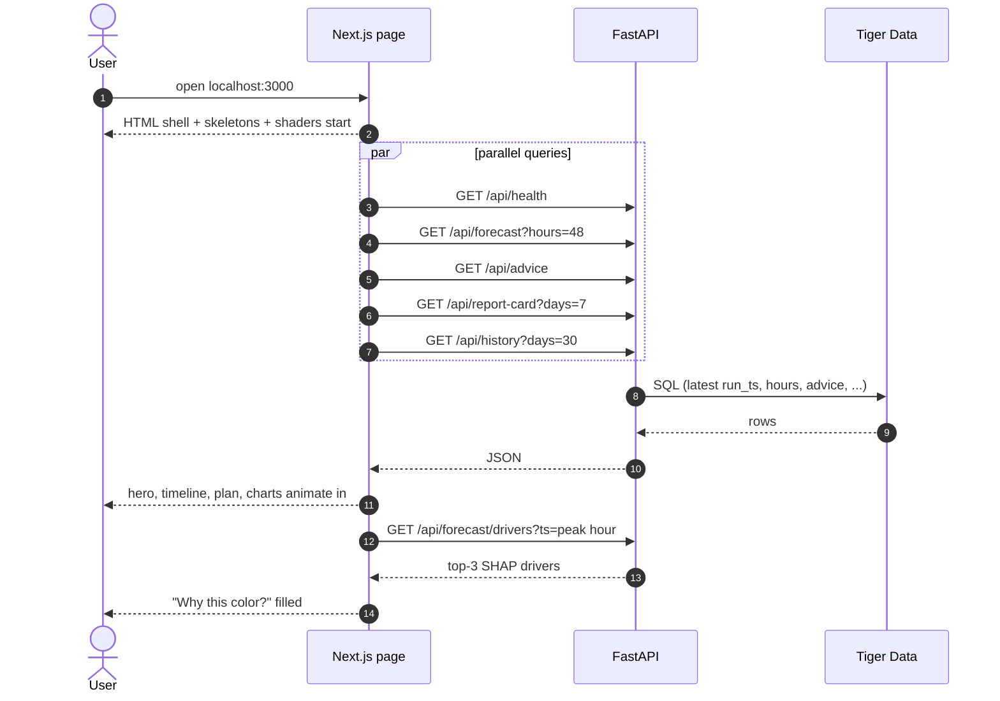

### 7.2 Chat

{{V9}}

Interactive Mermaid version (renders on GitHub)

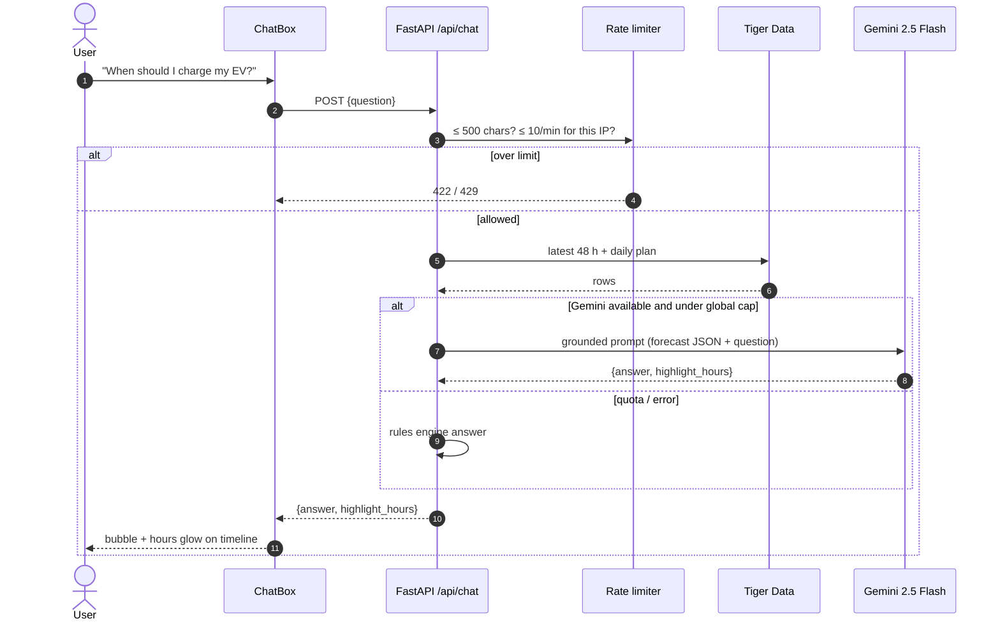

### 7.3 Ripple simulator

{{V10}}

Interactive Mermaid version (renders on GitHub)

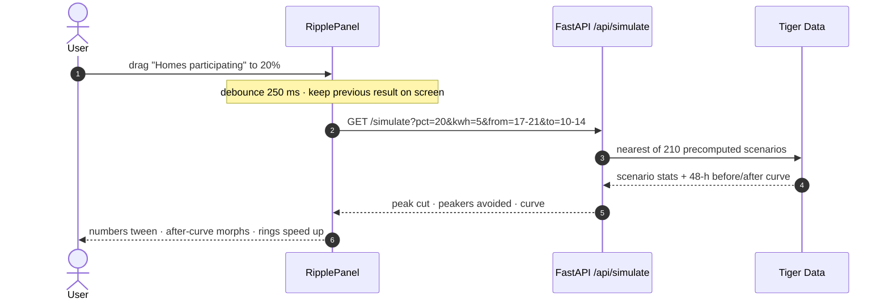

---

## 8. Freshness: how new data reaches the page

{{V11}}

Interactive Mermaid version (renders on GitHub)

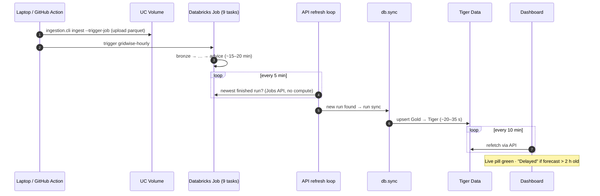

| Trigger | What runs |
|---|---|
| `python -m tools.dev` | `db.sync` once at startup, then API + dashboard |
| API running | Jobs API poll every 5 min → auto `db.sync` |
| Forecast > 2 h old | API also checks Gold `max(run_ts)` via the SQL warehouse (≤ every 30 min) |
| Manual | `python -m db.sync` |

---

## 9. Resilience and fallbacks

{{V12}}

Interactive Mermaid version (renders on GitHub)

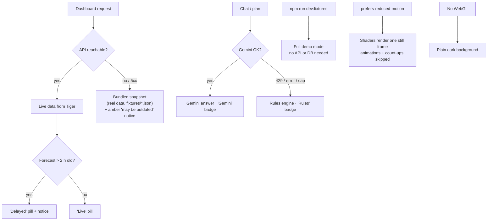

---

## 10. Visual layer: shaders and motion

{{V13}}

Interactive Mermaid version (renders on GitHub)

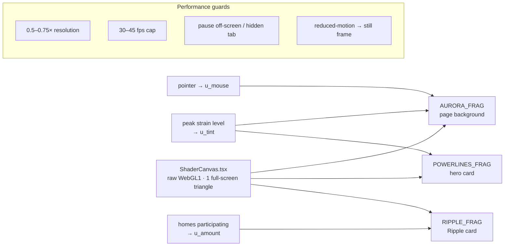

| Shader | Where | What it shows | Driven by |
|---|---|---|---|
| **Aurora** | Fixed page background | Domain-warped energy field + aurora band, pointer glow, film grain | Tomorrow's worst strain level (red / amber / green tint) |
| **Power lines** | Hero card | 6 glowing transmission lines with travelling current pulses | Strain color, intensity ↑ when red |
| **Ripple rings** | Ripple card | Water rings from multiple "homes" | Participation slider: more sources, faster, brighter |

**Motion** (`motion.tsx`, motion v12): `Reveal` (fade-up once), `Stagger`/`StaggerItem`, `AnimatedNumber` (count-up), `PulseDot` (live indicator). All respect reduced-motion.

**Surfaces:** frosted glass cards (`backdrop-filter: blur(18px)`), 1 px gradient border lit at the top edge, hover glow.

---

## 11. Deployment topologies

### 11.1 Local (current)

{{V14}}

Interactive Mermaid version (renders on GitHub)

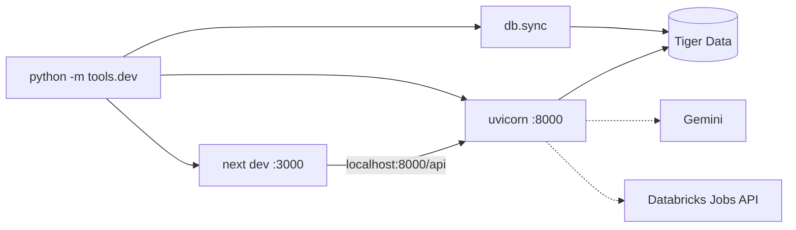

### 11.2 Single VM (ready: Vultr / any Docker host)

{{V15}}

Interactive Mermaid version (renders on GitHub)

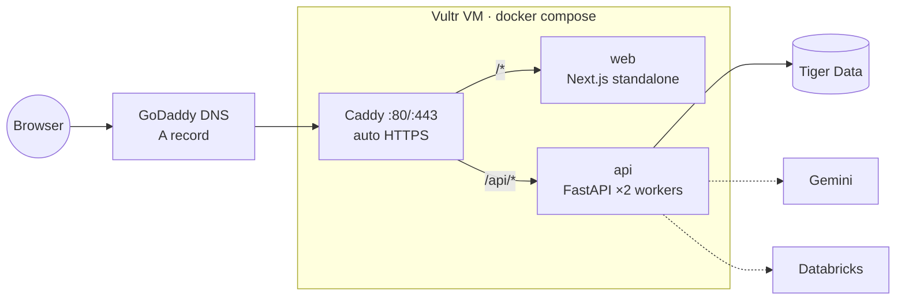

`python -m tools.deploy_vultr --host <IP> [--domain example.tech]`. Locally verified end-to-end in Docker.

### 11.3 Serverless (ready: Vercel)

{{V16}}

Interactive Mermaid version (renders on GitHub)

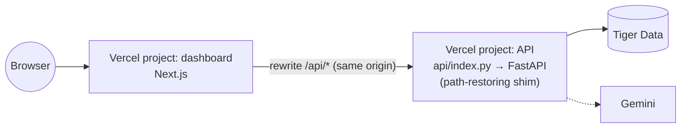

Config is in the repo (`vercel.json`, `api/index.py`, `.vercelignore`, `tools/vercel_env.py`). It was deployed and verified, then **taken down on request**. Redeploying takes about 2 minutes. On serverless the auto-sync loop is off; run `db.sync` from a laptop.

---

## 12. Security model

{{V17}}

Interactive Mermaid version (renders on GitHub)

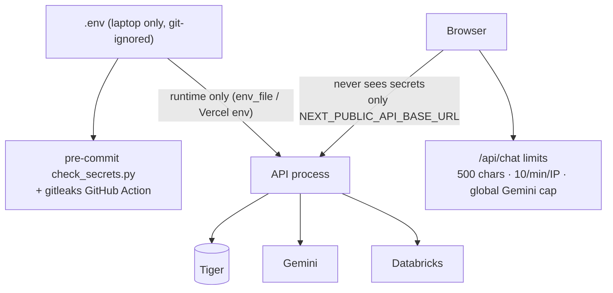

- Secrets live only in `.env` (and the runtime environment); never in git, images, or client JS.
- `.dockerignore` / `.vercelignore` exclude every `.env*` file.
- Only ports 80/443 are public in the VM topology; containers run as non-root.
- The Databricks token is never sent to serverless hosts.

---

## 13. Tech stack summary

| Layer | Technology |
|---|---|
| Sources | ERCOT (gridstatus), EIA-930 API, Open-Meteo |
| Lakehouse | Databricks Free Edition: UC Volumes, Auto Loader, Delta, Jobs, SQL warehouse, Genie |
| ML | LightGBM, MLflow, Unity Catalog model registry, SHAP |
| AI | Gemini 2.5 Flash (plan, Why-red, chat) |
| Serving DB | Tiger Data: PostgreSQL 18 + TimescaleDB 2.31 (hypertables, continuous aggregate) |
| API | FastAPI, psycopg 3 + pool, uvicorn |
| Frontend | Next.js 15 (App Router, TS), Tailwind v4, Recharts, TanStack Query, motion v12, lucide, Geist |
| Graphics | Raw WebGL1 fragment shaders (aurora, power lines, ripple) |
| Deploy | `tools/dev.py` (local) · Docker + Caddy + Vultr · Vercel |
| Security | `.env` only, pre-commit scanner, gitleaks Action, chat rate limits |

**Run locally:** `python -m tools.dev` → dashboard http://localhost:3000 · API docs http://localhost:8000/api/docs
